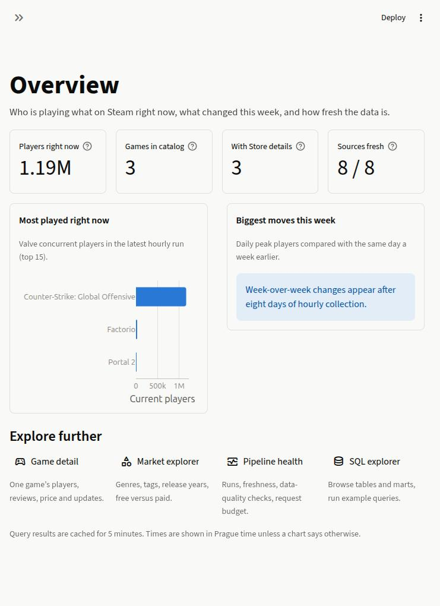

# Steam Data Pipeline

A layered data pipeline for Steam games. It collects a SteamSpy catalog,
hourly Valve player counts, Steam Store details and prices, review history and
update news; lands every API response untouched; loads normalized tables with
history; rebuilds analytics marts; checks its own data; and presents it all in
a Streamlit dashboard. It runs as one Docker Compose app on a home TrueNAS
server.

It is a data-engineering portfolio project, built around one principle that
came out of a real incident: every number shown says where it comes from and
what its timestamp means.



## Architecture

```mermaid
flowchart LR
    subgraph sources["API sources"]
        spy["SteamSpy<br>catalog, tags"]
        valve["Valve Web API<br>players, leaderboard, news"]
        store["Steam Store<br>details, prices, reviews"]
    end

    subgraph jobs["Jobs (in-process scheduler)"]
        players["players_hourly<br>every hour"]
        catalog["catalog_daily<br>20:00"]
        reviews["reviews_daily<br>20:30"]
    end

    raw[("Raw landing<br>raw_api_responses")]
    normalized[("Normalized<br>games, observations, dimensions,<br>price history, review history, events")]
    marts[("Marts<br>rebuilt after every job")]
    quality[("data_quality_results")]
    dashboard["Streamlit dashboard"]

    sources --> jobs
    jobs --> raw
    raw --> normalized
    normalized --> marts
    normalized --> quality
    marts --> quality
    marts --> dashboard
    quality --> dashboard
```



Every request is stored in the raw layer before parsing; the jobs parse the
stored copy into the normalized tables; SQL transforms rebuild the marts after
every job, and the data-quality checks run on the result. Table-level detail
is in [`docs/lineage.md`](docs/lineage.md) and
[`docs/data_dictionary.md`](docs/data_dictionary.md).

Docker Compose manages these services:

- `mysql` — persistent database.
- `db-bootstrap` — creates or repairs the read-only dashboard account and the
  pipeline's writer account.
- `migration-assets` — copies migrations from the application image.
- `migrate` — applies pending Flyway migrations and exits.
- `scheduler` — runs the collection jobs on their schedules (see
  [Jobs](#jobs)).
- `pipeline` — optional one-shot manual run of all or some jobs.
- `dashboard` — provides the interactive analytics interface.

Startup order is enforced:

```text
MySQL healthy → bootstrap and migrations complete → scheduler and dashboard start
```

## What this project demonstrates

- **Data contracts**: every source documented with fields, timestamp meaning,
  freshness, rate limits and caveats, plus recorded responses —
  [`docs/sources.md`](docs/sources.md),
  [`tests/fixtures/sources/`](tests/fixtures/sources/).
- **Raw landing layer**: responses stored before parsing, hash
  deduplication, retention, and reprocessing of any run —
  [`src/ingest/raw_store.py`](src/ingest/raw_store.py),
  [`src/reprocess.py`](src/reprocess.py),
  [ADR 2](docs/adr/0002-raw-landing-layer-with-hash-dedup.md).
- **Layered model**: raw → normalized → marts, versioned with Flyway —
  [`db/migrations/`](db/migrations/), [`db/transforms/`](db/transforms/),
  [`docs/data_dictionary.md`](docs/data_dictionary.md),
  [`docs/lineage.md`](docs/lineage.md).
- **Incremental, idempotent loads**: daily rollups rebuilt for touched days,
  keyed upserts that never let older data overwrite newer, per-run reprocessing
  that reproduces identical rows —
  [`src/jobs/players.py`](src/jobs/players.py),
  [`src/jobs/review_history.py`](src/jobs/review_history.py),
  [`tests/integration/test_raw_layer.py`](tests/integration/test_raw_layer.py).
- **Backfills**: years of source-dated review history and news on demand —
  [`src/backfill.py`](src/backfill.py).
- **History tracking (SCD Type 2)**: price versions with validity ranges —
  [`db/migrations/V8__price_history.sql`](db/migrations/V8__price_history.sql),
  [`src/jobs/prices.py`](src/jobs/prices.py),
  [ADR 3](docs/adr/0003-price-history-as-scd2.md).
- **Normalization of messy inputs**: company strings with commas inside
  names, HTML language lists, free-text release dates —
  [`src/parsing/`](src/parsing/), [`tests/test_parsing.py`](tests/test_parsing.py).
- **Request budgets**: rate limits planned per job and enforced with pauses —
  [`docs/request_budget.md`](docs/request_budget.md).
- **Data observability**: freshness, volume, staleness, duplicate rates,
  schema drift, table invariants and mart tests stored after every run —
  [`src/quality/checks.py`](src/quality/checks.py),
  [`docs/observability.md`](docs/observability.md).
- **Orchestration**: per-job schedules, locks, run audit, abandoned-run
  reaping, DST-safe waits — [`src/scheduler.py`](src/scheduler.py),
  [`src/jobs/base.py`](src/jobs/base.py),
  [ADR 1](docs/adr/0001-mysql-and-in-process-scheduling.md).
- **Analytics engineering**: rolling windows, volatility, sentiment drift,
  event impact, Prague time without time-zone tables —
  [`db/transforms/`](db/transforms/), [`docs/marts.md`](docs/marts.md).
- **Honest data**: a documented stale-data incident and the design changes
  that followed —
  [Stale-data incident](#stale-data-incident-september-2026),
  [ADR 4](docs/adr/0004-steamspy-for-catalog-not-time-series.md).
- **Testing**: unit tests, integration tests against a real migrated MySQL,
  and replay of recorded API responses through the whole path —
  [`tests/`](tests/), [`.github/workflows/tests.yml`](.github/workflows/tests.yml).
- **Delivery and operations**: tests gate image publishing, release tags pin
  the TrueNAS deployment, least-privilege database accounts, a generated data
  dictionary checked in CI —
  [`.github/workflows/`](.github/workflows/),
  [`docker-compose.yml`](docker-compose.yml),
  [`scripts/generate_data_dictionary.py`](scripts/generate_data_dictionary.py).

## Technology

- Python 3.12
- Pandas
- Requests
- MySQL 8.0
- Flyway
- Streamlit
- Plotly
- Docker Compose
- `unittest`

## Data model

### `games`

Relatively stable game metadata:

- App ID and name
- Developer and publisher
- Languages and genre as raw SteamSpy strings (empty for games loaded from the
  SteamSpy catalog page, which does not include these fields; use the
  normalized tables below instead)
- First and most recent appearance in the extraction

### Normalized dimensions

Loaded by `catalog_daily`. Lookup tables hold each value once; bridge tables
link games to them.

- `companies`, `game_developers`, `game_publishers`: split from SteamSpy's
  developer and publisher strings for every loaded game on every run
  (`position` keeps SteamSpy's order). The splitting rule is a heuristic,
  documented in [`docs/sources.md`](docs/sources.md#parsing-rules).
- `game_details`: Steam Store type, release date (and its original text),
  coming-soon flag, free-to-play flag, required age, Metacritic score,
  Windows/Mac/Linux flags, recommendation count, `store_available`, and when
  the details and tags were last fetched.
- `genres` + `game_genres`, `categories` + `game_categories`: the Store's
  genre and category IDs and English names.
- `languages` + `game_languages`: supported languages, with `full_audio`.
- `tags` + `game_tags`: SteamSpy user tags with their vote counts.

Each catalog run refreshes Store details and tags for the
`STORE_DETAILS_PER_RUN` (default 120) games that have gone longest without a
refresh, new games first, so a 1,000-game catalog is refreshed about every 9
days. A failed refresh keeps the previous values and adds a run warning; a
game the Store no longer returns is marked `store_available = FALSE` and keeps
its last known details.

### `game_price_history` and `game_price_summary`

Each catalog run checks the price of every catalog game in batches of 50
(`filters=price_overview`, country `STEAM_STORE_COUNTRY`) and keeps a Type 2
history: one row per price version per game and country, with `valid_from`,
`valid_to` and `is_current`. A changed price closes the current version and
opens a new one; an unchanged price writes nothing. `price_state` records
`priced`, `no_price` (sold without a price, such as free to play) or
`unavailable` (the Store returned no data), so a free-to-paid change or a
removal from sale is a version like any other. Amounts are in the currency's
minor unit (cents for USD) and are never compared across currencies.

The `game_price_summary` view adds, per game and country: the current price
and discount, whether the game is on sale, the lowest price recorded (in the
latest currency), the number of discount events (a version that starts a
discount after a full-price one), and the days since the last discount ended.

Reprocessing a catalog run does not replay its price check, because price
history only moves forward.

### `game_metric_snapshots`

Append-only SteamSpy values for each pipeline run. `snapshot_time` is the
collection time; SteamSpy does not expose the underlying source measurement
time:

- Owner estimate range and midpoint
- Positive and negative reviews
- Review score
- Lifetime and recent playtime
- SteamSpy-reported `ccu` (the source measurement time is unknown)
- Current and original price
- Discount percentage

### `player_observations`, `player_daily`, `most_played_daily`

Collected by the hourly `players_hourly` job:

- `player_observations`: one row per game per run, with current players,
  rank, `collected_at`, Valve's `source_measured_at` (top-100 feed only), and
  `source` (`top100` or `direct`). Rows older than
  `PLAYER_HOURLY_RETENTION_DAYS` (default 90) are deleted.
- `player_daily`: per game and UTC day, the peak, average and minimum players,
  the number of observations and the best rank. The days touched by each run
  are recomputed after it; rollups are kept forever.
- `most_played_daily`: Valve's daily-peak leaderboard (top 100 by peak
  players, with last week's rank) for the previous complete UTC day. It is not
  limited to catalog games.

Top-100 games that are not in `games` are skipped (the run logs their count).
Tracked games outside the top 100 get a direct player lookup.

### `review_observations`

Collected by the daily `reviews_daily` job for the games in
`STEAM_TRACKED_APPIDS`: Steam review totals across all languages and purchase
types (including off-topic activity), the positive share, and Steam's rating
(`review_score`, `review_score_desc`, e.g. "Very Positive"), with
`collected_at`.

### `review_rollups`, `review_reconciliation`, `game_events`

Also collected by `reviews_daily` for the tracked games:

- `review_rollups`: up and down review counts per month for each game's whole
  life, and per day for the last 30 days, from Steam's review histogram. The
  dates are the source's own (the first day of each period, UTC), so this is
  real history, not values reconstructed from daily snapshots. The current
  month and day are marked `is_partial`. Rows are upserted by game, rollup
  type and period, and an older fetch never overwrites a newer one.
- `review_reconciliation`: each run compares the histogram's monthly totals
  with that run's review summary. The two endpoints count different review
  sets (Phase 10 found totals differing by up to 15%), so the count
  difference is only recorded; the positive share must agree within 2
  percentage points, or the run gets a warning.
- `game_events`: Steam news and update posts with their publication time,
  feed, `is_patch_notes` (Steam's `patchnotes` tag) and `is_developer_post`
  (the developer's own announcements, as opposed to press articles). Each
  news `gid` is stored once; later runs add only new ones. Article text is not
  stored.

### `steam_game_measurements` (read-only)

The combined player and review measurements of the single daily run used
before the job split. Its rows were copied into `player_observations` and
`review_observations`; the table is kept unchanged for audit and is no longer
written.

### `raw_api_responses`

The raw landing layer. Every API request the pipeline makes is recorded here
**before** anything parses it, and parsers read the stored copy rather than
the live response:

- source, endpoint, request parameters (JSON) and their hash, HTTP status,
  fetch time (UTC), and any connection error;
- the response body, zlib-compressed, with its SHA-256 and uncompressed size.

When a response is byte-identical to the previous one for the same source and
request, only its metadata is stored, with `is_duplicate_of` pointing at the
row that holds the body. A long run of duplicates is therefore a cheap,
built-in sign of a stale source.

Bodies older than `RAW_RETENTION_DAYS` (default 30) are removed at the end of
each catalog run; metadata rows are kept forever. A body that a newer duplicate
still points to is kept until that duplicate is old enough too.

### `pipeline_runs`

Operational audit information, one row per job run:

- Job (`job_name`: `catalog_daily`, `players_hourly`, `reviews_daily`, or
  `daily_legacy` for runs before the job split)
- Start and finish timestamps
- Status
- Rows extracted and loaded (`rows_extracted`, `rows_loaded`)
- Observations loaded (`measurements_loaded`; runs before the job split were
  backfilled from `steam_game_measurements`)
- Rows rejected by validation (`rows_rejected`); before this column existed,
  any invalid row failed the whole run, so historical runs show 0
- Failure message, and a separate `warning_message` for runs that succeeded
  with degraded input

SteamSpy rows are validated before loading. Problems with the whole response
fail the run: an empty response, missing columns, or duplicate app IDs.
Problems with a single row reject only that row: a missing or empty name, a
missing or malformed `owners` range, negative counts, a review score outside
0-100, or review totals that do not add up. Rejected rows are not loaded. The
run logs the first 20 rejected app IDs with their reasons, stores the count in
`rows_rejected`, and adds a short summary to `warning_message`. If more than
`PIPELINE_MAX_REJECTED_PERCENT` of rows are rejected, the run fails instead,
because that usually means the source format changed.

Only one run of a job can be active at a time. Each run takes the MySQL named
lock `steam_pipeline:<job>` before it creates a run row; if another run of the
same job holds the lock, the new run logs a warning and exits without creating
a row. While holding the lock, a run marks its job's leftover `RUNNING` rows as
`FAILED` with `error_message = 'Abandoned: process ended before completion'`.
Their `finished_at` stays empty because the process never finished. This
covers runs interrupted by a crash or container restart.

If recording a failure itself fails (for example, the database connection is
lost), the pipeline logs that secondary error and re-raises the original one.

All database timestamps are stored in UTC. The dashboard converts displayed run times to `Europe/Prague`.

## Dashboard

A Streamlit multipage app (`src/dashboard.py` and `src/dashboard_pages/`).
Every chart has a caption saying where its numbers come from and what its
timestamp means.

The sidebar groups the pages into **Explore** (Overview, Game detail, Market
explorer) and **Operate** (Pipeline health, SQL explorer), and shows a status
badge for each job's latest run (ok, warnings, late, failed) with its age,
plus a link to Pipeline health when data checks fail. Each page opens with
bordered headline numbers and then splits its detail into tabs. Charts share
one style (`src/dashboard_style.py`): a palette checked for colour-vision
deficiency, where a colour always means the same job or series, blue/red only
for rise/fall, and status always shown with an icon and a label. The theme
is black and orange, in `.streamlit/config.toml`; orange leads the chart
palette.

| Page | Shows |
| --- | --- |
| Overview | players right now (Valve) with the change since the previous hour, games in the catalog, sources fresh; most played now; biggest week-over-week moves; links to the other pages |
| Game detail | Store attributes and SteamSpy tags; daily peak, average and 7-day average players with patch-notes markers; top-100 rank; hourly players; review sentiment drift and monthly review history; price history as a step chart |
| Market explorer | genre and tag summaries, release-year groups, free versus paid |
| Pipeline health | jobs healthy, sources fresh, failed checks and the busiest Store window at a glance; tabs for run history and durations per job, freshness per source, data-quality problems, SteamSpy staleness and raw duplicate rates, request budget used versus planned |
| SQL explorer | tables, views and marts with their columns, and predefined example queries |


More screenshots: [game detail](docs/screenshots/game-detail.jpg),
[market explorer](docs/screenshots/market-explorer.jpg),
[pipeline health](docs/screenshots/pipeline-health.jpg),
[SQL explorer](docs/screenshots/sql-explorer.jpg). They were taken on a
throwaway stack seeded from the recorded API responses, so trends cover a
single day.

Behaviour shared by all pages:

- Query results are cached for 5 minutes, so a finished run can take up to
  5 minutes to appear. The SQL explorer's "Run example" button always queries
  the database directly.
- Series built per run or per day have one point per run or day, and a run
  or day without data leaves a gap instead of a line drawn across it.
- Valve player points use Valve's source time when available, otherwise the
  collection time, otherwise the run's finish time.
- Games are selected by app ID and shown as `name (appid)`, so two games with
  the same name stay distinct.

To try the dashboard without calling the APIs, seed an empty database from
the recorded responses in `tests/fixtures/sources/`:

```bash
docker compose run --rm pipeline python src/reprocess.py --seed-fixtures
```

## Jobs

The scheduler runs three jobs, each with its own run rows
(`pipeline_runs.job_name`), lock and warnings:

| Job | Default schedule | Collects | Writes |
| --- | --- | --- | --- |
| `players_hourly` | every hour at :07 | Valve top-100 chart, direct lookups for tracked games outside it, daily-peak leaderboard | `player_observations`, `player_daily`, `most_played_daily` |
| `catalog_daily` | 20:00 | SteamSpy catalog page, SteamSpy `appdetails` for tracked games off the page, Store details and SteamSpy tags for the stalest games, Store prices for all catalog games | `games`, `game_metric_snapshots`, normalized dimensions, `game_price_history` |
| `reviews_daily` | 20:30 | Steam review summaries, review histograms and news for tracked games | `review_observations`, `review_rollups`, `review_reconciliation`, `game_events` |

Times are in `PIPELINE_TIMEZONE` (default `Europe/Prague`). Hourly runs are
scheduled in UTC, so they stay exactly one hour apart across DST changes;
daily runs keep their wall-clock time. Jobs run one at a time; when several
are due together they run in the order above. A failing job is logged and
the others continue.

`catalog_daily` makes sure every tracked game has a `games` row, which player
and review observations need. A tracked game that is not on the configured
SteamSpy page is fetched with SteamSpy `request=appdetails`, one request per
game with a pause of just over one second before each (SteamSpy's limit is
one such request per second). The result is shaped like a page row, so the
game gets a `games` row and a snapshot. If that lookup fails, the run records
a warning and skips the game. Because of this, `rows_extracted` can exceed
1,000. Top-100 games that are neither on the page nor tracked are not
fetched; the players job skips them and logs their count.

A job's lock (`steam_pipeline:<job>`) stops the same job from running twice,
for example a manual run during a scheduled one. At start, a job marks its
own leftover `RUNNING` rows as abandoned; it never touches other jobs' runs.

SteamSpy is the core source: if the catalog request fails, the
`catalog_daily` run fails. Valve and Store data are enrichment, so their
failures degrade a run instead of aborting it: the run still ends as
`SUCCESS`, and each problem is logged and stored in
`pipeline_runs.warning_message` (up to 2,000 characters).

- Top-100 chart fails: every tracked app falls back to a direct player
  lookup, so those rows have no rank and no source timestamp.
- A player or review lookup fails for an app: that app has no row for the
  run.
- The daily-peak leaderboard fails: the players run keeps its observations.

Every source, including candidates for future phases, is documented in
[`docs/sources.md`](docs/sources.md) with its fields, timestamp meaning,
freshness, rate limit and caveats. Recorded example responses are in
`tests/fixtures/sources/`. Requests per job and source are budgeted in
[`docs/request_budget.md`](docs/request_budget.md).

## Analytics marts

Derived metrics live in mart tables rebuilt after every job by the SQL files
in `db/transforms/`, each in its own transaction and followed by SQL tests
(key uniqueness, non-null keys, row count, value ranges). They cover player
trends (rolling averages, day- and week-over-week change, top-100 entries and
exits, volatility, typical peak hour in Prague time), review trends (new
reviews, 30-day versus lifetime positive share), price status, genre, tag and
release-year summaries, rough engagement ratios, and player averages around
patch releases. Grain, sources, refresh and caveats for each mart are in
[`docs/marts.md`](docs/marts.md).

## Data observability

After every job the pipeline checks its own data and stores every result in
`data_quality_results`: freshness per source, daily volume against a 7-day
median, how many SteamSpy values stayed unchanged between catalog runs (the
September 2026 incident as a permanent monitor), raw-payload duplicate rates,
schema drift against the fields in `docs/sources.md`, invariants for every
table, and the mart tests. A failing check never deletes data; it adds a run
warning that the dashboard shows. Checks and thresholds are documented in
[`docs/observability.md`](docs/observability.md).

## SQL analytics

The project includes views for:

- Latest successful pipeline run
- Current metrics from that run
- Top games by estimated owners
- Best-reviewed games
- Games with the highest SteamSpy-reported CCU
- Free, paid and unknown-price comparisons
- Publisher summaries
- Historical game trends
- Changes between consecutive snapshots using `LAG()`
- Daily pipeline reliability per job
- Current price, lowest price and discount history per game
  (`game_price_summary`)

The richer derived metrics live in the [analytics marts](#analytics-marts).

Views contain reusable analytical logic. Final dashboard queries control sorting and row limits explicitly.

## Project structure

```text
.
├── .github/workflows/        CI: unit + integration tests, gated image publishing
├── .streamlit/config.toml    dashboard theme
├── db/migrations/            Flyway: versioned V*__ schema changes, repeatable views
├── db/transforms/            SQL that rebuilds each analytics mart after every job
├── deploy/                   TrueNAS Custom App definition
├── docs/                     sources, data dictionary, lineage, marts,
│                             observability, budget, ADRs, screenshots
├── src/
│   ├── api/                  HTTP calls to SteamSpy and Steam, via the raw layer
│   ├── ingest/               raw landing layer, fixture and raw replay sessions
│   ├── jobs/                 run lifecycle (lock, run row, raw store) and jobs
│   ├── marts/                mart build step and mart SQL tests
│   ├── parsing/              pure parsers for API payloads
│   ├── quality/              row-level validation
│   ├── transform/            SteamSpy row transformation
│   ├── database/             MySQL connection
│   ├── dashboard.py          Streamlit entry point and page navigation
│   ├── dashboard_pages/      the dashboard pages
│   ├── dashboard_common.py   shared queries, caching and formatting
│   ├── dashboard_data.py     pure chart shaping (gaps, price steps, budget)
│   ├── dashboard_style.py    palette, chart style, cards and status badges
│   ├── main.py               run the pipeline once
│   ├── reprocess.py          rebuild a run from its stored raw responses
│   ├── scheduler.py          in-process scheduler
│   └── config.py             environment configuration
├── scripts/                  data dictionary generator
├── tests/
│   ├── fixtures/sources/     recorded API responses (see docs/sources.md)
│   ├── integration/          tests against a real MySQL (INTEGRATION_DB=1)
│   └── test_*.py             unit tests
├── .env.example
├── CHANGELOG.md
├── docker-compose.yml
├── Dockerfile
└── requirements.txt
```

## Prerequisites

Install:

- Git
- Docker
- Docker Compose

No local Python installation, MySQL server, or MySQL Workbench is required.

Verify:

```bash
git --version
docker --version
docker compose version
```

## Linux setup

Clone the repository:

```bash
git clone https://github.com/infish/steam-data-pipeline.git
cd steam-data-pipeline
```

Create the private configuration file:

```bash
cp .env.example .env
```

Generate four separate passwords:

```bash
openssl rand -hex 24
openssl rand -hex 24
openssl rand -hex 24
openssl rand -hex 24
```

Open `.env` and assign them to:

- `MYSQL_ROOT_PASSWORD`
- `PIPELINE_DB_PASSWORD` — schema owner, used only by Flyway migrations
- `WRITER_DB_PASSWORD` — used by the scheduler and manual pipeline runs
- `DASHBOARD_DB_PASSWORD` — read-only dashboard account

The bootstrap service writes the database name, the dashboard and writer user
names, and their passwords into SQL. It refuses to run unless each value
contains only letters, digits, `_` and `-`. Hex passwords from
`openssl rand -hex` always qualify.

Never commit `.env`. It is excluded by both Git and Docker.

Collection settings use these defaults:

| Variable | Default | Meaning |
| --- | --- | --- |
| `STEAMSPY_MODE` | `all` | SteamSpy catalog request |
| `STEAMSPY_PAGE` | `0` | SteamSpy catalog page |
| `STEAM_TRACKED_APPIDS` | `730,427520,620` | App IDs enriched with reviews and direct player fallback |
| `PIPELINE_MAX_REJECTED_PERCENT` | `5` | Fail the run if more than this % of SteamSpy rows fail validation |
| `RAW_RETENTION_DAYS` | `30` | Days to keep raw response bodies; metadata is kept forever |
| `STORE_DETAILS_PER_RUN` | `120` | Games whose Store details and tags each catalog run refreshes (0–140) |
| `STEAM_STORE_COUNTRY` | `us` | Store country code; sets the price currency |
| `PLAYER_HOURLY_RETENTION_DAYS` | `90` | Days to keep hourly player observations; daily rollups are kept forever |
| `PIPELINE_TIMEZONE` | `Europe/Prague` | Timezone of the job schedule |
| `JOB_PLAYERS_MINUTE` | `7` | Minute past every hour for `players_hourly` |
| `JOB_CATALOG_TIME` | `20:00` | Local time for `catalog_daily` |
| `JOB_REVIEWS_TIME` | `20:30` | Local time for `reviews_daily` |
| `PIPELINE_RUN_ON_STARTUP` | `false` | Optional immediate collection on scheduler startup |

`PIPELINE_RUN_HOUR` and `PIPELINE_RUN_MINUTE` from earlier versions still set
the catalog time when `JOB_CATALOG_TIME` is not given, both in `.env` for
Docker Compose and directly in a TrueNAS YAML.

Keep `PIPELINE_RUN_ON_STARTUP=false` for persistent deployments. Container
restarts otherwise create extra observations unrelated to the daily schedule.

## Start the complete project

```bash
docker compose up --build -d
```

Check service states:

```bash
docker compose ps -a
```

Expected lifecycle:

- MySQL: running and healthy.
- Flyway: exited with code `0`.
- Scheduler: running and waiting for the configured daily time.
- Pipeline: absent unless a manual run was requested.
- Dashboard: running and healthy.

Open the dashboard:

[http://localhost:8501](http://localhost:8501)

The Compose port mapping publishes the dashboard on port `8501` on all host
interfaces. Restrict it with a firewall or change the mapping to
`127.0.0.1:8501:8501` if it should only be reachable locally.

## Run jobs manually

Run all three jobs once, in order (catalog, players, reviews):

```bash
docker compose run --rm pipeline
```

Run only some jobs:

```bash
docker compose run --rm pipeline python src/main.py players_hourly
```

The scheduler does not collect on container startup, which avoids duplicate
observations during app restarts. Manual runs remain available for focused
validation.

## Backfill review history or news

Load review history or news for chosen games outside the schedule (the games
need a `games` row):

```bash
docker compose run --rm pipeline python src/backfill.py --source review_histogram --appids 730,620
```

```bash
docker compose run --rm pipeline python src/backfill.py --source news --appids 730 --count 100
```

Without `--appids`, the tracked games are used. The backfill runs as its own
`backfill` job with a run row, lock and raw responses. Running it again adds
nothing new: review periods and news items are keyed and upserted.

## Reprocess a run

Rebuild a run's loaded rows (snapshots, player or review observations,
depending on its job) from its stored raw responses, without calling any API:

```bash
docker compose --profile manual run --rm pipeline python src/reprocess.py --run-id 42
```

The run's responses are replayed through the same parsing and loading code
as the original run, in one transaction that first deletes the run's loaded
rows, so running it twice gives the same result. Only successful runs made
after the raw landing layer existed can be reprocessed, and only while their
payload bodies are within `RAW_RETENTION_DAYS`. Reprocessing uses the current
configuration; a request the original run did not make fails like an
unreachable API and becomes a warning.

## View logs

```bash
docker compose logs pipeline
docker compose logs dashboard
docker compose logs mysql
```

Follow dashboard logs continuously:

```bash
docker compose logs -f dashboard
```

## Stop the project

```bash
docker compose down
```

The MySQL named volume remains intact.

To intentionally delete the development database and recreate it from scratch:

```bash
docker compose down -v
```

Warning: `-v` permanently deletes all snapshots stored in the Docker volume.

## Query MySQL without Workbench

Open the MySQL command-line client as the pipeline account:

```bash
docker compose exec mysql sh -c \
  'MYSQL_PWD="$MYSQL_PASSWORD" mysql -u"$MYSQL_USER" "$MYSQL_DATABASE"'
```

Example SQL:

```sql
SELECT COUNT(*)
FROM current_game_metrics;

SELECT
    games.name,
    observations.collected_at,
    observations.source_measured_at,
    observations.current_players,
    observations.player_rank
FROM player_observations AS observations
JOIN games ON games.appid = observations.appid
ORDER BY observations.collected_at DESC
LIMIT 20;

SELECT name, observation_date, peak_players, avg_players_7d,
       peak_change_pct_wow
FROM mart_player_trends
ORDER BY observation_date DESC, peak_players DESC
LIMIT 20;
```

Exit the MySQL client with:

```text
exit
```

## Database migrations

Flyway reads SQL from:

```text
db/migrations/
```

Migration types:

- `V1__description.sql` — versioned migration, executed once.
- `V2__description.sql` — next schema change.
- `R__description.sql` — repeatable migration, rerun when its contents change.

Do not edit an already-applied versioned migration. Create the next numbered migration instead.

## Run automated tests

Tests run inside the application image and do not require local Python packages:

```bash
docker compose run --build --rm --no-deps \
  -e PYTHONPATH=/app/src \
  pipeline \
  python -m unittest discover -s tests -v
```

The API tests use mocks and never contact SteamSpy or Valve endpoints.

### Integration tests

Integration tests in `tests/integration/` run the pipeline against a real,
migrated MySQL database with canned API payloads. They are skipped unless
`INTEGRATION_DB=1` is set, and they refuse to run unless `MYSQL_DATABASE` ends
in `_test`, because every test deletes all pipeline rows.

Run them in a throwaway Compose project with its own database volume. The
tests clear tables between runs, which the pipeline's writer account cannot
do, so they connect as the schema owner. Load `.env` into the shell first;
`-e MYSQL_USER -e MYSQL_PASSWORD` then passes those values through without
putting the password on the command line:

```bash
set -a; . ./.env; set +a
MYSQL_USER="$PIPELINE_DB_USER" MYSQL_PASSWORD="$PIPELINE_DB_PASSWORD" \
MYSQL_DATABASE=steam_pipeline_test docker compose -p steam-test \
  --profile manual run --build --rm \
  -e INTEGRATION_DB=1 -e PYTHONPATH=/app/src \
  -e MYSQL_USER -e MYSQL_PASSWORD \
  pipeline \
  python -m unittest discover -s tests/integration -t tests -v
```

Remove the throwaway project afterwards:

```bash
docker compose -p steam-test --profile manual down -v
```

Never run integration tests against the `steam_pipeline` database used by a
real deployment. CI runs the same tests in the `integration-tests` job against
a MySQL service container migrated with Flyway.

## Security

- MySQL is not published to the host network.
- Database files live in a Docker named volume.
- Credentials are stored in an ignored `.env` file.
- The dashboard uses an account restricted to `SELECT` and `SHOW VIEW`.
- The scheduler and manual pipeline use a writer account restricted to
  `SELECT`, `INSERT`, `UPDATE` and `DELETE`; it cannot create, drop or alter
  tables. `DELETE` is needed for retention and reprocessing. The schema owner
  is used only by Flyway.
- `db-bootstrap` re-applies the dashboard and writer passwords on every start,
  so rotating a password in `.env` takes effect on the next
  `docker compose up -d`.
- The MySQL healthcheck and bootstrap pass the root password through the
  `MYSQL_PWD` environment variable rather than on a command line.
- Arbitrary SQL input is not accepted by the dashboard.
- Streamlit accepts connections on the container network; the host-side port
  mapping determines where the dashboard is exposed.
- Python services run as an unprivileged container user.

Do not expose the Streamlit port directly to the public internet. Use an authenticated reverse proxy or a private network such as Tailscale if remote access is required.

## Stale-data incident: September 2026

The original pipeline treated every successful SteamSpy response as a fresh
measurement. That was incorrect. Both SteamSpy's bulk and per-app endpoints
returned unchanged values across repeated collections, while the database gave
each response a new `snapshot_time`. The timestamp represented collection time,
not the time SteamSpy measured the underlying value. As a result, the dashboard
plotted flat series that looked current even though the source values were
stale. For example, 7 Days to Die repeatedly displayed SteamSpy `ccu` of
`17,045` while Valve reported roughly `29,000` current players during diagnosis.

The first correction added authoritative Valve measurements for three test
games, but the dashboard still exposed the legacy SteamSpy chart for every
catalog game. Games outside that initial set therefore continued to show the
same misleading flat series. The completed correction:

- collects Valve's top-100 concurrent-player feed once per run;
- uses direct Valve player lookups for configured games outside that feed;
- records Valve's source timestamp when the feed supplies one;
- keeps collection time separate and uses it only as an explicit fallback;
- charts only Valve measurements while retaining SteamSpy snapshots for audit;
- excludes stale SteamSpy player, review, and price fields from regular
  dashboard analyses and the in-dashboard SQL Explorer;
- avoids fabricating or backfilling historical Valve values.

Duplicate observations had two scheduling causes. The scheduler originally ran
on container startup, and its single long sleep could wake fractionally before
the intended deadline and run twice. A separate user-level systemd timer was
also invoking the manual pipeline alongside the Compose scheduler. Startup
collection is now disabled, the scheduler rechecks its deadline after waking,
and the duplicate local systemd timer was disabled. Persistent deployments
should run exactly one scheduling mechanism.

## Data limitations

SteamSpy remains useful for catalog metadata and broad comparisons, but its
values are not treated as authoritative time-series measurements.

Important limitations:

- `owners` is an estimated range.
- The midpoint is useful for comparisons but is not an exact count.
- Owned copies are not equivalent to sales.
- SteamSpy does not provide source measurement timestamps. `snapshot_time` is
  only when this pipeline collected the response, and a successful response
  does not establish freshness.
- Valve's current-player endpoint may be cached upstream for a short interval.
- Valve supplies `source_measured_at` for its top-100 player feed. Direct player
  and review-summary calls do not include a source timestamp, so charts fall
  back to the explicitly labeled `collected_at` value for those observations,
  and to the run's finish time for runs that did not measure the game.
- Steam review totals use `language=all`, `purchase_type=all`, and
  `filter_offtopic_activity=0`. Moderation or classification changes can make
  totals decrease as well as increase.
- Recently released and low-ownership games may have unreliable estimates.
- `request=all` returns 1,000 games per page and is rate-limited.

The Game detail page warns when the latest three hourly player counts or daily
review totals of a game are identical, and the pipeline-health checks track
how many SteamSpy values stay unchanged between catalog runs. Legacy SteamSpy snapshots remain queryable for audit purposes but
are no longer charted because their collection timestamps do not establish
freshness.

Run exactly one scheduler. The Compose `scheduler` is the supported default;
disable any older cron or systemd timer that also invokes the manual `pipeline`
service.

These limitations should be considered when interpreting charts and derived metrics.

## Releases and image tags

The `Publish Docker image` workflow builds the application image and pushes it
to GHCR. It first runs the full test workflow (unit and integration tests); if
any test fails, no image is published.

Each published image gets these tags:

| Tag | When |
| --- | --- |
| full commit SHA | every build |
| `latest` | builds from `main` only |
| `vX.Y.Z` | builds from a pushed `vX.Y.Z` git tag |

A release tag never moves `latest`. `deploy/truenas-compose.yml` references a
`vX.Y.Z` tag, never `latest`.

To cut a release:

1. On a branch, set the new version in all four `image:` lines of
   `deploy/truenas-compose.yml`, and add the version to the top `CHANGELOG.md`
   heading. Merge the branch into `main`.
2. Tag the merge commit on `main` and push the tag:

   ```bash
   git switch main && git pull
   git tag -a v1.0.1 -m "v1.0.1"
   git push origin v1.0.1
   ```

3. Wait for the `Publish Docker image` run for that tag to finish
   successfully, then confirm the image exists:

   ```bash
   docker pull ghcr.io/infish/steam-data-pipeline:v1.0.1
   ```

4. In TrueNAS, edit the app's YAML to use the new tag and save.

To roll back, change the tag back to the previous release. This is safe only
if the newer release added no database migrations, because Flyway migrations
are not reversed.

## TrueNAS SCALE deployment

The project can be deployed on TrueNAS SCALE as a single Custom App using the
**Install via YAML** interface.

### Architecture

The TrueNAS deployment runs:

- MySQL 8 with persistent storage
- a one-shot database bootstrap service
- Flyway migrations
- a persistent Python scheduler
- the Streamlit dashboard
- an optional manual one-shot pipeline service

The application image is pinned to a release tag:

```text
ghcr.io/infish/steam-data-pipeline:v1.0.1
```

Deploy only a tag whose image has been published (see
[Releases and image tags](#releases-and-image-tags)). Pinning means updating
the app never picks up unreleased changes from `main`.

Before installing `deploy/truenas-compose.yml`:

1. Replace all four `CHANGE_ME_*` password placeholders with distinct strong
   values, for example from `openssl rand -hex 24`. Passwords may contain only
   letters, digits, `_` and `-`.
2. Confirm `/mnt/Apps/steam-data-pipeline/mysql` is the intended persistent
   dataset path.
3. Keep the tracked app list small and leave startup collection disabled.

Paste the resulting YAML into the Custom App editor and deploy it. Flyway
applies additive migrations before the scheduler and dashboard start. Updating
the app recreates containers but preserves the MySQL host-path data.

### Upgrading an existing TrueNAS deployment

Deployments created before the writer account existed connect the scheduler as
the schema owner. To upgrade:

1. **Before** updating the app, copy the current YAML from the TrueNAS editor
   as a rollback copy, then prepare the new YAML outside the repository (it
   will hold passwords): start from the current `deploy/truenas-compose.yml`,
   fill in your existing root, schema owner and dashboard passwords, and
   replace `CHANGE_ME_WRITER` with a new value such as
   `openssl rand -hex 24`. The writer user and password appear in
   `db-bootstrap`, `scheduler` and `pipeline` and must match in all three.
   Keep your existing user and database names: if the old YAML's schema owner
   is not `pipeline` (older deployments used `steam_pipeline`), use the old
   name for `MYSQL_USER` under `mysql`, `PIPELINE_DB_USER` under
   `db-bootstrap` and `FLYWAY_USER` under `migrate`. MySQL reads the root and
   schema owner passwords only when it creates a new database, so they must
   stay exactly as they are; a mismatch shows as `Access denied` in the
   `migrate` log, before any migration runs.
2. Check that the dashboard password contains only letters, digits, `_` and
   `-`. If not, replace it in both `db-bootstrap` and `dashboard`; bootstrap
   applies the new value.
3. Make sure the image tag in the YAML has been published (see
   [Releases and image tags](#releases-and-image-tags)).
4. Save the YAML. TrueNAS recreates the containers. If the app fails to
   start, `sudo docker logs ix-steam-data-pipeline-db-bootstrap-1` and
   `sudo docker logs ix-steam-data-pipeline-migrate-1` in the TrueNAS shell
   name the problem.

The **Web UI** button on the app's Application Info card opens the dashboard
(the `x-portals` block at the end of the YAML). TrueNAS reads that block only
when the app is first installed; on an app installed earlier, open
`http://<nas-address>:8501` directly.

On start, `db-bootstrap`:

- refuses to run, with a message naming the variable, if a user name or
  password is missing or contains other characters, or if the writer user is
  the same as the schema owner or dashboard user;
- creates the writer account if it does not exist;
- sets the dashboard and writer passwords to the values in the YAML;
- grants the dashboard `SELECT, SHOW VIEW` and the writer
  `SELECT, INSERT, UPDATE, DELETE` on the database.

It does not change the root or schema owner accounts and does not touch data.
The `mysql` container restarts once because its environment no longer carries
dashboard credentials.

If bootstrap fails, the scheduler does not start and no collection happens; the
dashboard and stored data are unaffected. Fix the YAML and save again. To roll
back, restore the previous YAML; the unused writer account is harmless.

A local Docker Compose deployment upgrades the same way: add `WRITER_DB_USER`
and `WRITER_DB_PASSWORD` to `.env` (see `.env.example`), then run
`docker compose up -d`.
