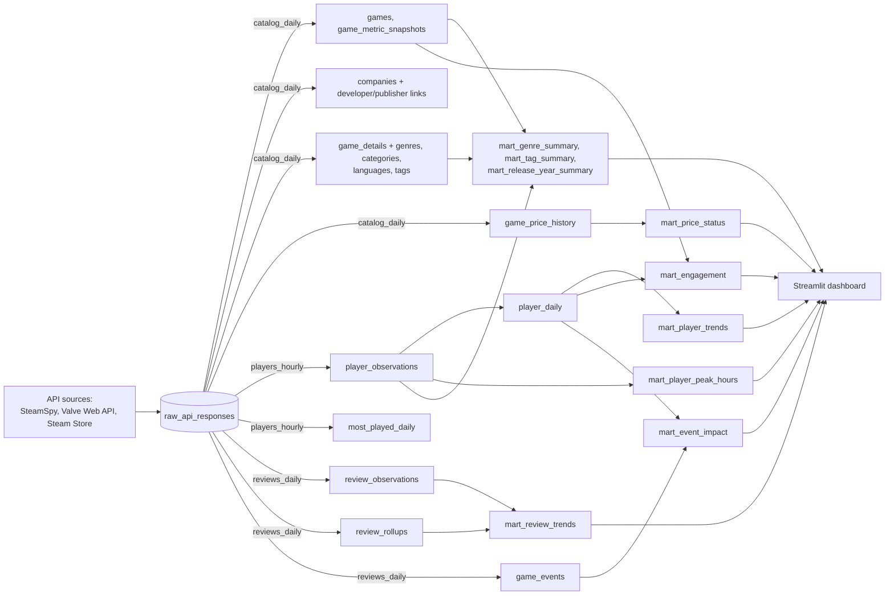

# Lineage

How data flows from each API source to the dashboard. Every source request is
first stored in `raw_api_responses`; the jobs parse the stored copy into the
normalized tables; the marts are rebuilt from those after every job.

## Per mart

| Mart | Built from | Fed by job(s) | API sources |
| --- | --- | --- | --- |
| `mart_player_trends` | `player_daily`, `games` | `players_hourly` | Valve top-100 chart, Valve current players |
| `mart_player_peak_hours` | `player_observations`, `games` | `players_hourly` | Valve top-100 chart, Valve current players |
| `mart_review_trends` | `review_observations`, `review_rollups`, `games` | `reviews_daily` (and `backfill`) | Steam review summary, Steam review histogram |
| `mart_price_status` | `game_price_summary` view over `game_price_history`, `games` | `catalog_daily` | Store price batch |
| `mart_genre_summary` | `game_genres`, `genres`, `game_details`, `current_game_metrics` (→ `game_metric_snapshots`, `games`), `player_observations` | `catalog_daily`, `players_hourly` | Store app details, SteamSpy catalog page, Valve top-100 chart |
| `mart_tag_summary` | `game_tags`, `tags`, `game_details`, `current_game_metrics`, `player_observations` | `catalog_daily`, `players_hourly` | SteamSpy app details (tags), Store app details, SteamSpy catalog page, Valve top-100 chart |
| `mart_release_year_summary` | `game_details`, `current_game_metrics` | `catalog_daily` | Store app details, SteamSpy catalog page |
| `mart_engagement` | `player_daily`, `current_game_metrics`, `games` | `players_hourly`, `catalog_daily` | Valve top-100 chart and current players, SteamSpy catalog page |
| `mart_event_impact` | `game_events`, `player_daily`, `games` | `reviews_daily` (news), `players_hourly` | Steam news, Valve top-100 chart and current players |

## Supporting tables

| Table | Built from | Job | API sources |
| --- | --- | --- | --- |
| `games`, `game_metric_snapshots` | SteamSpy rows (catalog page plus tracked-game backfill) | `catalog_daily` | SteamSpy catalog page, SteamSpy app details |
| `companies`, `game_developers`, `game_publishers` | `games.developer`, `games.publisher` strings | `catalog_daily` | SteamSpy catalog page |
| `game_details`, `genres`, `categories`, `languages` and their links | Store app details | `catalog_daily` | Store app details |
| `tags`, `game_tags` | SteamSpy app details | `catalog_daily` | SteamSpy app details |
| `game_price_history` | Store price batches | `catalog_daily` | Store price batch |
| `player_observations`, `player_daily` | top-100 chart and direct lookups | `players_hourly` | Valve top-100 chart, Valve current players |
| `most_played_daily` | daily-peak leaderboard | `players_hourly` | Valve most played |
| `review_observations`, `review_reconciliation` | review summaries (and histograms) | `reviews_daily` | Steam review summary, Steam review histogram |
| `review_rollups` | review histograms | `reviews_daily`, `backfill` | Steam review histogram |
| `game_events` | news items | `reviews_daily`, `backfill` | Steam news |
| `data_quality_results` | all of the above, after the job that owns each check | every job | — |
| `run_steps` | timing of each run's steps | every job | — |
